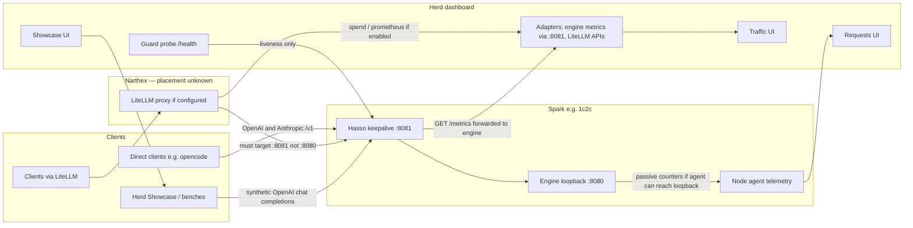

# Telemetry design (Requests, Traffic, Showcase, adapters)

**Status:** proposed  
**Date:** 2026-11-06 (America/New_York)  
**Authoring branch:** `vadig/telemetry-profiles` (follow-up to merged [#116](https://github.com/airhamer/herd/pull/116))  
**Defect:** [#118](https://github.com/airhamer/herd/issues/118) `[COMP2]` implementation gaps (project board Todo). Spec PR [#117](https://github.com/airhamer/herd/pull/117).  
**Does not implement** the architecture. This is an ADR for later spec-based work.  
**License:** herd stays MIT. Upstream sparkDash has been Apache-2.0 since [v2.0.0](https://github.com/MiaAI-Lab/sparkDash/commit/5051a33db3aa6ddc875dca1bf4cc71939d49af59) (license text commit `5051a33`, 2026-10-09). This note inspects upstream source to explain mechanisms and cites pinned commits. It does **not** copy upstream code. Later implementation must be written from this specification, not transplanted from sparkDash. After this inspection, that work is not independent clean-room authorship.

---

## 1. Decision

Herd should treat **organic traffic observation** and **on-demand Showcase / bench load** as two different products that share a canonical metric vocabulary.

- Keep the client contract: Hasso keepalive on the Spark (`:8081` on the recorded 1c2c install; upstream Hasso default `:30001`) fronts the engine (`:8080` / default `:30000`, loopback). Do not require a herd usage-relay hop in front of that path.
- Observe organic traffic with **adapters** (engine counters and `/metrics` reached through the keepalive front, optional LiteLLM spend/gateway APIs). Mark every number with provenance, freshness, and whether a missing probe is **unknown** rather than zero.
- Use Showcase (and Decode / Prefill benches) only as **operator-triggered synthetic load**. Never mix those timings unmarked into “natural workload” history.
- Keep `LLM_PROXY` as an **optional fallback** for engines that expose neither cumulative counters nor a metrics API — not as the default way to fill Traffic. There is still no mandatory extra proxy hop. Preserve Hasso `:8081` → engine `:8080` protections (or the equivalent Hasso defaults `:30001` → `:30000`).
- Herd’s Settings “Guard proxy” is an **adapter** to the same Hasso keepalive process (or any URL the operator types), not a second proxy daemon.
- A **Component** owns a reusable runtime profile: serving path and endpoints (engine, optional Hasso/guard, optional LiteLLM route), credential *references*, monitoring adapters and declared metric capabilities, and resource/lifecycle actions. Catalog defaults come from runtime profiles; node/group overrides must be explicit.
- **Standard vs uncensored** (or any other weight/model variant) are **subcomponents** of that Component. Swapping a compatible variant must not change component identity, endpoint/route bindings, monitoring profile/adapters, credential references, or recording policy. Do not infer monitoring architecture from a model display name.
- Traffic metadata is the **default**. Prompt and response recording is an **explicit opt-in** (see §11 and §18). Passive engine `/metrics` cannot record payloads; a request-level observer (LiteLLM or a compatible optional proxy/relay) is required when recording is on.

---

## 2. Current facts versus this proposal

### Facts on herd `main` (code citations still use `8dc99d0`; `bd93f8c` merged this ADR as [#116](https://github.com/airhamer/herd/pull/116))

- Guard Proxy setting (`guardProxy.baseURL`) probes `GET /health` then `GET /`. 401/403 count as alive. It does not scrape `/metrics` and does not fill Traffic. Docs: [docs/guard-proxy.md](https://github.com/airhamer/herd/blob/8dc99d0/docs/guard-proxy.md). Probe: [server/health/guardProbe.js](https://github.com/airhamer/herd/blob/8dc99d0/server/health/guardProbe.js). Route: [server/index.js](https://github.com/airhamer/herd/blob/8dc99d0/server/index.js) (`GET /api/guard`).
- A leftover S4.1 list (`settings.guard.endpoints`) still probes `GET /guard/status` then `/health` looking for `heldRequests` and `crashTimeline`. That URL shape is a herd assumption; it is not confirmed in current public Hasso docs.
- Node-agent `collectProxy` detects `qwen38-keepalive` locally and guesses port 8081. Fleet Showcase uses that port when the proxy reports running ([server/showcase/fleetTargets.js](https://github.com/airhamer/herd/blob/8dc99d0/server/showcase/fleetTargets.js), SC11).
- **Requests** tab is queued / running / finished from the agent’s engine probe (`snap.llm` → `snap.requests`). It does **not** need `LLM_PROXY`. Empty means `llm[]` was empty (or the UI hid a null payload), not “relay off.” SGLang finished-count is documented as 0 when the engine has no counter ([agent/main.js](https://github.com/airhamer/herd/blob/8dc99d0/agent/main.js) enrichment).
- **Traffic** lane totals can come from engine counters; **Recent requests** come only from `llmProxy[].recent` ([server/fleet/traffic.js](https://github.com/airhamer/herd/blob/8dc99d0/server/fleet/traffic.js)). No relay ⇒ “Proxy off” and no per-request rows.
- `LLM_PROXY` syntax in code is `listen:upstream` port pairs (example `8082:8081`), bind `LLM_PROXY_BIND` default `127.0.0.1` ([agent/main.js](https://github.com/airhamer/herd/blob/8dc99d0/agent/main.js), [agent/proxy/usageRelay.js](https://github.com/airhamer/herd/blob/8dc99d0/agent/proxy/usageRelay.js) `parseRelaySpec`). Issue #104 and open PR #111 docs that show `127.0.0.1:8082->http://…` do **not** match the parser.
- Agent versions in source: 0.3 already exports vLLM/SGLang `engineCounters`; 0.4 adds every engine plus monotonic meta; 0.5 adds `LLM_PROXY` / `proxyCounters` ([server/fleet/engineWindows.js](https://github.com/airhamer/herd/blob/8dc99d0/server/fleet/engineWindows.js), [agent/telemetry.js](https://github.com/airhamer/herd/blob/8dc99d0/agent/telemetry.js) `AGENT_VERSION = "0.5.0"`). Issue #98 copy that says “engine counters need 0.4+” is slightly wrong. Issue #104’s claim that live 1c2c still runs 0.3.0 was not re-verified here.
- Herd already has a MIT fleet Showcase ([server/showcase/FleetShowcaseManager.js](https://github.com/airhamer/herd/blob/8dc99d0/server/showcase/FleetShowcaseManager.js)) and historical `server/collectors/ShowcaseManager.js` / `LlmStreaming.js` / `LlmProbe.js` from the MIT-era fork. New telemetry work should extend the MIT fleet path and adapters, not import more Apache-2.0 sparkDash text.
- LiteLLM appears only as a Narthex service name ([HANDOFF.md](https://github.com/airhamer/herd/blob/8dc99d0/HANDOFF.md)) and as an example of an OpenAI-compatible gateway that may need a stored Bearer ref. Listen URL and upstream for 1c2c are **not** in git.

### Open PRs this design should survive (not edited here)

[#109](https://github.com/airhamer/herd/pull/109) catalog matching, [#110](https://github.com/airhamer/herd/pull/110) discrete VRAM, [#111](https://github.com/airhamer/herd/pull/111) Traffic prerequisites (still uses the 0.4+/arrow-syntax wording above), [#112](https://github.com/airhamer/herd/pull/112) standalone topology, [#113](https://github.com/airhamer/herd/pull/113)–[#115](https://github.com/airhamer/herd/pull/115) updates, [#114](https://github.com/airhamer/herd/pull/114) Components in drill-down.

### Proposal (not yet code)

Adopt the source matrix, schema, and staged migration below. Configuration examples later in this file are proposals unless marked as existing parser support.

---

## 3. Upstream findings (sparkDash)

**Repository:** [MiaAI-Lab/sparkDash](https://github.com/MiaAI-Lab/sparkDash) (public, Apache-2.0).  
**Inspected HEAD:** [`e89f8d1db621b4756063ece7771c0d08edc818b5`](https://github.com/MiaAI-Lab/sparkDash/commit/e89f8d1db621b4756063ece7771c0d08edc818b5) (2026-11-06, “fix(overview): shorten the decode and prefill tile captions”).  
**Latest release:** [v2.32.0](https://github.com/MiaAI-Lab/sparkDash/releases/tag/v2.32.0) (2026-10-10) → commit [`230cdde99c9be668ccadcbc64a4a93349581eb1b`](https://github.com/MiaAI-Lab/sparkDash/commit/230cdde99c9be668ccadcbc64a4a93349581eb1b). HEAD is newer than the release.

README (same HEAD) states that live tok/s comes from **diffing cumulative server counters**, and that sparkDash **does not send its own request** just to measure speed; Decode bench, Prefill bench, and Prompt Showcase measure speed **on demand**: [README.md](https://github.com/MiaAI-Lab/sparkDash/blob/e89f8d1db621b4756063ece7771c0d08edc818b5/README.md) (features / monitoring section around the “never sends a request of its own” paragraph). The Prompt Showcase is documented as a full-page multi-terminal streaming demo (up to 32 prompts) with live tok/s.

### 3.1 Prompt Showcase — synthetic, not a sniffer

[ShowcaseManager.js](https://github.com/MiaAI-Lab/sparkDash/blob/e89f8d1db621b4756063ece7771c0d08edc818b5/server/collectors/ShowcaseManager.js) runs **operator-started** sessions:

- UI: pick a Spark, prompts (1–32), max tokens (64–2048), temperature, optional thinking. `POST` starts one session per Spark; 409 if a showcase, decode, prefill, or quality bench is already running.
- The dashboard process opens concurrent streamed `POST http://<llmHost>:<port>/v1/chat/completions` with `stream: true` and `stream_options.include_usage`. It prefers vLLM-oriented `min_tokens` / `ignore_eos` to fill the budget, then retries without those fields on HTTP 400.
- Protocol: **OpenAI chat completions only** in this manager. It does not post Anthropic `/v1/messages`.
- Cancel: user stop, or no poll/heartbeat for about 5 seconds. Per-stream abort plus a 360 s timeout.
- History: last 20 finished runs per Spark in `config/showcase-history.json`, including **full prompt and generated text** (privacy contrast with herd Traffic’s **default** metadata-only ring; opt-in content recording is proposed in §11, not implemented today).
- In parallel it polls the engine’s generation counters about every 400 ms ([`pollServerGenerationRates`](https://github.com/MiaAI-Lab/sparkDash/blob/e89f8d1db621b4756063ece7771c0d08edc818b5/server/collectors/LlmStreaming.js)) so a “server tok/s” strip can sit beside per-stream client timing.

This **creates load**. Tokens and TTFT from a Showcase run are generated-benchmark / demo timings, not a sample of leftover user traffic. Organic user calls that happen to share the engine will also move the same cumulative `/metrics` counters (see §3.3).

Herd’s MIT [FleetShowcaseManager.js](https://github.com/airhamer/herd/blob/8dc99d0/server/showcase/FleetShowcaseManager.js) already documents the same idea: client stream timing plus optional server Δtokens/Δt, archived as bench source `"showcase"`.

### 3.2 Stream parser — how Showcase times a request

[LlmStreaming.js](https://github.com/MiaAI-Lab/sparkDash/blob/e89f8d1db621b4756063ece7771c0d08edc818b5/server/collectors/LlmStreaming.js) (shared by Showcase, Decode bench, Prefill bench):

- Sends `Accept: text/event-stream` and parses OpenAI-style `data:` JSON. Visible text comes from `choices[0].delta.content` plus reasoning fields (`reasoning` or `reasoning_content`, not both). Empty SSE chunks (including Hasso keepalive pings with no visible text) **do not** start TTFT.
- Live token counts estimate **~4 characters per token**; final completion tokens prefer `usage.completion_tokens` when present.
- **TTFT (`ttftMs`)**: time from request send to first visible token (reasoning or answer). A separate `ttftContentMs` waits for the first non-reasoning answer token.
- **Decode window**: first visible token → last visible token (not stream EOF), so a trailing usage/`[DONE]` event does not drag the rate. Decode tokens are `completionTokens - 1` when completion tokens > 0.
- **Prefill rate as published by this parser**: `prefillTokens / ttftMs`. Prefill token count prefers `usage.prompt_tokens`, else the same ~4 chars/token estimate of the request body. If the backend provides llama.cpp-style `timings.prompt_ms` / `prompt_n`, those are stored separately (`serverPromptMs` / `serverPromptN`) but the published `prefillTps` still divides by TTFT.

That last point is a **measurement definition problem**, not something herd should copy as “engine prefill.” TTFT includes queueing, prefix-cache lookup, reasoning-before-answer, and network. Dividing prompt tokens by TTFT is an estimate and must be labeled as such. Chunk-to-chunk gaps after the first token are decode ITL, not prefill.

Anthropic `/v1/messages` event types (`content_block_delta`, and so on) are not what this OpenAI SSE walker keys on. Hasso’s public client surface includes `/v1/messages`; Showcase would not time those streams unless something translates them first.

Auth: optional `Authorization: Bearer` from the Spark’s stored LLM API key (same key used for probe / bench). Host selection: [llmHost.js](https://github.com/MiaAI-Lab/sparkDash/blob/e89f8d1db621b4756063ece7771c0d08edc818b5/server/collectors/llmHost.js) — local Sparks use loopback so a 127.0.0.1 engine is reachable from a host-network dashboard; remotes use `llmHost` or `lanIp`, with an SSH tunnel fallback after repeated failures (CHANGELOG notes a past tunnel encoding bug).

Cancellation uses `AbortSignal`. Idle HTTP timeouts on the shared streaming agent are disabled so a long prefill is not cut at 300 s; the caller’s abort still bounds the request.

### 3.3 LlmProbe — passive observation of whatever the engine already did

[LlmProbe.js](https://github.com/MiaAI-Lab/sparkDash/blob/e89f8d1db621b4756063ece7771c0d08edc818b5/server/collectors/LlmProbe.js) scrapes engine HTTP (`/metrics`, SGLang `/server_info` or `/get_server_info`, `/v1/loads`, backend-specific paths). It **does not** send chat completions to measure speed.

What it can show depends on the backend (unsupported means null, not a fake 0, in the well-behaved paths):

| Kind | Typical source (names as scraped) | Notes |
| --- | --- | --- |
| Generation tok/s | Δ cumulative output tokens / Δt, or a moving gauge | vLLM `vllm:generation_tokens_total`; SGLang `sglang:generation_tokens_total` or `sglang_generation_tokens_total`; also ds4, q27, flare, splash series in the shared reader. SGLang `last_gen_throughput` is **sticky** — only treated as live while it changes, then expired (~6 s). |
| Prefill tok/s | Backend-specific counter windows | TensorFold docs in-file warn that cached vs computed mixes make short windows swing wildly. Prefill bursts are held briefly then cleared when idle. |
| Queue / running | e.g. SGLang `num_running_reqs` (`/v1/loads` preferred) | Waiting/finished depend on the engine. |
| TTFT histogram p95 | Some Prometheus backends | Not universal. |
| Model id | `/v1/models`, info payloads | Hugging Face hub cache paths are shortened to `org/Name`. `owned_by` helps classify the engine. Deprecated SGLang info paths still work with a warning. |
| Uptime / restarts | Inferred when cumulative counters go backwards | [LlmTokenLedger.js](https://github.com/MiaAI-Lab/sparkDash/blob/e89f8d1db621b4756063ece7771c0d08edc818b5/server/llmtokens/LlmTokenLedger.js) reseeds the baseline and credits nothing (engine restart). |

[LlmTokenLedger.js](https://github.com/MiaAI-Lab/sparkDash/blob/e89f8d1db621b4756063ece7771c0d08edc818b5/server/llmtokens/LlmTokenLedger.js) diffs those cumulative totals per `(sparkId, port)` and attributes the delta to the model id seen at that moment. It is **all engine traffic**: user clients, LiteLLM (if it hit this engine), and Showcase/benches share one counter. A zero cached-token field is not a 0% hit rate unless `cacheReported` is true. Huge deltas are rejected as anomalies.

README also notes LM Studio and Ollama often publish **no** cumulative counters, so live tok/s tiles stay at 0 unless the operator runs a bench or Showcase.

### 3.4 What upstream can and cannot do for herd’s goals

**Can help (ideas, not code):**

- Separate “watch the engine’s own counters” from “send demo prompts.”
- Prefer server `usage.*` over character estimates; flag estimates.
- Decode rate = first visible token → last visible token.
- Do not let trailing usage events or empty keepalive chunks define TTFT.
- Diff cumulative counters for organic volume; treat counter reset as restart, not negative traffic.
- Mutex Showcase against other synthetic loads so the box is not double-stressed by accident.

**Cannot meet the goal by itself:**

- Showcase will never explain blank Traffic/Requests for *existing* opencode traffic; it would add more load and more tokens.
- Upstream Showcase history stores full generations. Herd’s **default** Traffic table stays metadata-only; full prompt/response recording is a separate, explicit opt-in (see §11), not something to copy blindly from Showcase history.
- Prefill-as-prompt-tokens/TTFT is not engine prefill.
- OpenAI-only Showcase does not certify Anthropic `/v1/messages` timings.
- Probe + ledger cannot tell Showcase tokens from user tokens without a separate provenance channel.
- SparkDash’s dashboard-centric probe assumes the dashboard can reach the engine host (loopback or tunnel). Herd’s fleet is node-agent / SSH first; the same *idea* should run **on the node** or through the keepalive front, not assume dashboard localhost is 1c2c.

---

## 4. Hasso keepalive metrics (public current source)

Pinned Hasso HEAD while writing: [`01902c67709c4164c30ccf036422bfed6f172158`](https://github.com/hasso5703/dgx-spark-qwen38/commit/01902c67709c4164c30ccf036422bfed6f172158) (2026-11-06, changelog v1.44.1). The user’s pasted install log recorded **v1.40.4**; do not assume the box matches this commit.

Verified from public docs and `keepalive-proxy.py` at that commit:

- Clients should use the keepalive port. Public default `:30001` → engine `:30000`. The 1c2c log used `:8081` → `:8080`.
- Keepalives during long prefills, abort when the client drops, request-safety guards, Bearer checked before reading a body, hold-across-restart ([docs/engine-restarts.md](https://github.com/hasso5703/dgx-spark-qwen38/blob/01902c67709c4164c30ccf036422bfed6f172158/docs/engine-restarts.md)).
- `GET /health`, `/ready`, and `/metrics` stay open without a key. Those paths are treated as engine-open routes and **GET is forwarded to the engine**; the proxy’s own `/metrics` body is the **engine’s** exposition (plus whatever the proxy does not add). There is **no documented proxy-owned Prometheus series for held-request count** in that file. Hold is journalled (`holding: …`) and implemented as an internal wait (`PROXY_HOLD_UNITS`, `PROXY_HOLD_MAX_S`, default 1200 s).
- Therefore “scrape Hasso `/metrics`” is, at current upstream, “scrape the engine `/metrics` through the protected front door” — which is desirable (loopback engine still reachable as `http://<spark>:8081/metrics` without `ENGINE_BIND=0.0.0.0`).
- Herd Guard Proxy today never requests `/metrics`, so a blank metrics line on the Guard panel does not prove the engine has none.

---

## 5. LiteLLM (official docs, version not pinned to Narthex)

Public docs (retrieved 2026-11-06; Narthex’s installed LiteLLM version is unknown):

- Router, virtual keys, retries/fallbacks: [Retries, fallbacks and cooldowns](https://docs.litellm.ai/docs/router/learn/reliability).
- Prometheus: [Prometheus metrics](https://docs.litellm.ai/docs/proxy/prometheus) (`litellm_total_tokens_metric`, input/output tokens, request counters, labeled by key/team/model when those exist).
- Per-request spend logs: [Spend tracking](https://docs.litellm.ai/docs/proxy/cost_tracking) (`/spend/logs/v2`). Default UI logs do **not** store prompt/response text; `store_prompts_in_spend_logs` is opt-in ([UI logs](https://docs.litellm.ai/docs/proxy/ui_logs)).
- Gateway request tiles count **one inbound request** even when retries/fallbacks fan out; spend logs record **each upstream attempt** ([Endpoint activity](https://docs.litellm.ai/docs/proxy/endpoint_activity)).
- Spend/log APIs typically need a database and an admin/master key. Without a DB, per-request logs may be absent even if the proxy routes traffic.
- Typical documented listen port is `:4000`. **Herd does not record Narthex’s port or whether LiteLLM’s upstream for 1c2c is `:8081` or `:8080`.** If the upstream were the raw engine, Hasso’s guards would be skipped.

Direct clients (opencode pointed at `:8081` by the Hasso installer) **bypass LiteLLM**. LiteLLM cannot be the only observation source unless every client is moved — which this design does not require.

---

## 6. Data-source / capability matrix

| Need | Organic user traffic | Showcase / Decode / Prefill | Notes |
| --- | --- | --- | --- |
| Queue, running, finished | Engine probe / `/v1/loads` / Prometheus queue gauges | Same counters, inflated while Showcase runs | Requests tab; SGLang finished may be unsupported (show unknown or documented 0). |
| Prompt / completion totals | Δ engine cumulative counters; LiteLLM spend/Prometheus if in path | Stream `usage.*` plus the same shared counters | Ledger must tag provenance; do not sum Showcase into “user tokens” unmarked. |
| Per-request tokens, TTFT, decode | LiteLLM spend/logs (if in path); Hasso does not document a per-request JSON log herd already understands; herd `LLM_PROXY` as fallback | Stream parser (synthetic) | Empty keepalive chunks excluded from TTFT if they carry no visible text. |
| Prefill rate | Engine `/metrics` prefill series **or** llama.cpp `timings.prompt_*` | Do not report `prompt_tokens/TTFT` as engine prefill | Mark estimate vs server-timed. |
| Model id / aliases | Engine `/v1/models` + catalog aliases (PR #109) | Response `model` field | |
| Uptime / restart | Counter reset; systemd/Hasso start-guard journal (not scraped today) | n/a | |
| Held requests / drain | Hasso journal / cockpit; not a verified `/metrics` series | n/a | Health: ready / loading / held / wedged are Hasso cockpit concepts (`/health` on the engine can be 200 while wedged — public Hasso README). |
| System / VRAM | Existing fleet telemetry | Unchanged | Per-node; group cards already aggregate carefully. |
| Errors | Engine + LiteLLM failed-request tiles + relay error counts | Stream HTTP errors | |

**True zero vs unknown:** a successful scrape that returns 0 waiting requests is zero. A missing series, failed scrape, auth gate without a parsed body, or old agent is **unknown** (`null` + reason). Never display that as `0` or “current.”

---

## 7. Recommended request and observation paths



Optional fallback (not drawn as required): `LLM_PROXY=8082:8081` on the **node**, clients that have no other meter pointed at `:8082`. Existing parser support is `listen:upstream` integers only. Upstream must stay the keepalive port so guards remain.

---

## 8. Canonical telemetry schema

Logical objects (names for implementers; not an on-disk format yet):

**`InferenceEndpoint`** (per node or group front): `nodeId` or `groupId`, `proxyUrl`, `enginePort`, `viaProxy`, `authRef` (secret ref only), `lastSeenAt`.

**`Observation`**: `metric`, `value` (number or null), `unit`, `source` (`engine-prom` | `engine-native` | `litellm-spend` | `litellm-gateway` | `litellm-prom` | `hasso-health` | `showcase-client` | `showcase-server` | `bench` | `relay` | `unknown`), `quality` (`measured` | `estimated` | `unsupported` | `unknown`), `observedAt`, `clock` (`mono` preferred for rates, `wall` for calendars), `resetPolicy` (cumulative since engine start; counter drop ⇒ restart, do not credit negative).

**`LogicalRequest` vs `Attempt`:** one client call may become several HTTP attempts (LiteLLM retry, Hasso hold then client retry). Gateway/inbound counts own the logical request. Spend logs and stream parses own attempts. Never add those two together.

**Correlation:** optional `traceId` if LiteLLM or the engine provides one; otherwise `(nodeId, port, wallMs, client, path, status, e2eS)` as Traffic already keys relay rows. Default rows store **metadata only**. Prompt/response text is stored only when an explicit recording policy is enabled for that route (see §11); never store credentials or auth headers.

**Exclusive aggregation ownership**

| Rollup | Owner | Do not also add |
| --- | --- | --- |
| Organic token volume per node/model | Engine counter diffs (or LiteLLM for *only* the subset that traversed LiteLLM) | Showcase stream totals |
| Queue depths | Engine probe | Relay in-flight, unless engine unsupported |
| Per-request table | One chosen source per row, stamped | A second source’s copy of the same attempt |
| Group TP request tokens | Count **once** at the group front / rank-0 logical request | Summing identical token totals across TP ranks |
| Group VRAM / power / temp | Per-node resources (sum or max as fleet cards already do) | Treating VRAM as request tokens |

Rates: `(Δtokens / Δt)` with a sane Δt window (reject idle, reject huge dt, reject negative Δ). Showcase decode rate uses first→last visible token as defined above.

---

## 9. Adapters and fallbacks (priority)

1. **Engine through Hasso** — `GET http://<node>:8081/metrics` and native info/load routes the node agent already understands. Preserves loopback engines. Same auth rules as today (`LLM_AUTH_TOKENS` / secret refs). Health stays `GET /health` (liveness) distinct from readiness/canary.
2. **LiteLLM** — if an endpoint record exists: Prometheus for labeled totals; `/spend/logs/v2` for attempts; gateway tiles for inbound logical requests. Requires configured admin access and usually a DB. Map `api_provider` / model / upstream URL to herd `nodeId` via explicit metadata — do not guess.
3. **Node-agent engine counters** — already on 0.3+ for SGLang/vLLM; richer on 0.4+. Powers Requests and Traffic lane totals without a relay.
4. **`LLM_PROXY`** — only if 1–3 cannot see a given engine (Ollama / LM Studio / llama.cpp without metrics). Listen on a new port; upstream **keepalive**, not the raw engine.

**Adapter profiles** (declared on the Component, validated at runtime — not inferred from the served model name):

| Profile | Role | Support claim |
| --- | --- | --- |
| LiteLLM | Optional front-door route, spend/gateway/Prometheus, request-level observer for opt-in recording | Documented public APIs; Narthex placement still unverified |
| SGLang | Engine-native counters, `/server_info`, `/v1/loads`, `/metrics` series | Used in fleet today |
| vLLM | Engine `/metrics` generation/queue series | Used in fleet today |
| Ollama | Often no cumulative counters (upstream README); may need bench/Showcase or relay fallback | Partial / capability-detected |
| llama.cpp | May expose `timings` on responses; `/metrics` not assumed | Partial / capability-detected |
| TensorFold | Prefill/cached series exist in inspected sparkDash probe code | **Unverified** on this fleet — extensibility hook, not a support claim |

Runtime discovery records each declared capability as supported+enabled, disabled, unreachable, unsupported, or unknown, with provenance and freshness. Swapping a model variant is **not** proof that metrics still work. Missing scrapes stay unknown, never a fake zero.

Capability discovery publishes which of 1–4 responded and when. Stale data keeps last-good values with `freshness: stale`, never silent zeros.

---

## 10. Health, loading, held

Do not collapse these:

| State | Meaning | Evidence |
| --- | --- | --- |
| Alive | Process answers | Guard `/health` or 401/403 gate |
| Ready | Serving real generations | Hasso cockpit canary; engine `/ready` if present — `/health` alone can be 200 on a wedged SGLang (public Hasso docs) |
| Loading | Weights / graphs / PLE table | Install log “still loading…”; unit active but not ready |
| Held | Keepalive is parking clients while the unit returns | Hasso journal `holding:`; not verified as a `/metrics` gauge |
| Stopped / unknown | No answer / no config | `reason` string |

---

## 11. Auth, reachability, retention

- Secret refs only (`env:`, `file:`), same as Guard Proxy and SRV1. Never put raw keys in Settings JSON, the browser, or any recording store. Auth headers are never recorded.
- Dashboard must not assume `localhost` is the Spark. Prefer node-agent on-box probes and `http://<node>:8081/...`.
- **Default (implemented today for Traffic relay rows, and the default going forward):** metadata only (time, path, model, status, tokens, latency, source). Herd already keeps an in-memory ring of the last 200 relay rows ([server/fleet/traffic.js](https://github.com/airhamer/herd/blob/8dc99d0/server/fleet/traffic.js)). No prompt or completion text.
- **Proposed opt-in content recording:** the operator may turn on prompt and/or response recording per node, group, or model route. This is new policy, not an existing settings parser. Effective policy is resolved by scoped inheritance with **stricter limits winning** (off beats on; shorter retention beats longer; smaller byte caps beat larger). A Component variant switch must not silently enable, disable, or bypass that policy.
- When recording is on, require a **request-level observer** (LiteLLM spend/logs with an explicit store-prompts setting, or a compatible optional proxy/relay that sees the request body). Passive `/metrics` and engine counters cannot reconstruct payloads — do not pretend they can. LiteLLM’s `store_prompts_in_spend_logs` stays off unless this opt-in is explicitly enabled for that route.
- Recorded content needs retention window, storage limits, deletion and access controls, a visible UI indicator that recording is active, and markers for incomplete streaming assemblies. Credentials and authorization headers are never stored.
- Showcase history that already stores full text is a **demo artifact**; keep it out of the organic Traffic table unless the same route’s recording policy explicitly allows it. Future Showcase UI copy should say the run is synthetic.

---

## 12. UI changes (when implemented)

**Requests:** Always render. If `llm[]` is missing, show “engine probe unavailable” with agent version / port / auth hints — not a blank page. Distinguish unsupported finished-count from zero. Showcase running is an optional banner (“synthetic load in progress; queue depths include demo traffic”).

**Traffic:** Lanes from engine counters without a relay (already possible). Recent rows from the chosen adapter (LiteLLM attempts or relay fallback), each with `source`. Prerequisites checklist should say: agent 0.3+ can already have SGLang/vLLM counters; 0.5+ for `LLM_PROXY`; `LLM_PROXY` format is `8082:8081`; Guard URL does not fill this table; LiteLLM only sees clients that used LiteLLM. Show a recording-on indicator when the effective policy stores content. Open PR [#111](https://github.com/airhamer/herd/pull/111) and issue [#104](https://github.com/airhamer/herd/issues/104) still need the version-floor and `LLM_PROXY` syntax corrections called out in §2 when next touched — not in this documentation change.

**Showcase:** Keep as an explicit Run action. Label timings “showcase session,” not “fleet workload.” Use first-visible-token TTFT; exclude empty keepalive chunks; if prefill is shown, prefer server `timings.prompt_*` or engine prefill series, otherwise “unsupported” rather than `prompt/TTFT` silently. Do not post Anthropic-shaped timings until a dedicated parser exists. Route through the keepalive port (SC11 already aims at this).

---

## 13. Configuration examples (proposals unless noted)

Existing, implemented:

```text
# Node agent — real parser (listenPort:upstreamPort)
LLM_PROXY=8082:8081
LLM_PROXY_BIND=127.0.0.1
```

```json
{
  "guardProxy": {
    "baseURL": "http://<spark-host>:8081",
    "apiKeyRef": "env:GUARD_PROXY_KEY"
  }
}
```

Proposed (not parsed today) — per-node observation record, to be designed into `config/nodes.json` or settings without storing secrets:

```json
{
  "inference": {
    "proxyUrl": "http://gx10-1c2c:8081",
    "enginePort": 8080,
    "viaProxy": true,
    "metricsPath": "/metrics",
    "litellm": {
      "baseUrl": "http://narthex:4000",
      "adminKeyRef": "env:LITELLM_ADMIN_KEY",
      "upstreamNodeId": "gx10-1c2c"
    },
    "recording": {
      "content": "off",
      "retentionHours": 24,
      "maxBytes": 10485760
    }
  }
}
```

`recording.content` values shown here are a **proposal** (`off` | `metadata` | `prompts` | `prompts+responses`). Nothing in herd parses this object today.

The `127.0.0.1:8082->http://127.0.0.1:8080` string is **not** valid `LLM_PROXY` input. Pointing a relay at `:8080` would also skip Hasso and is not recommended.

---

## 14. Migration plan

1. **This document** (done when merged). No runtime change.
2. Endpoint metadata + capability flags on the node snapshot (detected / unsupported / unknown / stale).
3. Scrape engine `/metrics` (and existing native routes) **via the keepalive URL** from the node agent; feed Traffic lanes and keep Requests on queue gauges.
4. Optional LiteLLM adapter behind explicit config; dual-path attribution (direct vs via-LiteLLM) without summing.
5. Align Traffic/Requests empty states with §12 (some of this is sketched in open PR #111; fix the version and `LLM_PROXY` syntax there when someone next touches it — not in this PR).
6. Showcase labeling and prefill definition on the MIT fleet Showcase path.
7. `LLM_PROXY` remains documented fallback only.
8. Component-owned serving/monitoring profiles and compatible variant (standard ↔ uncensored) swaps — [#118](https://github.com/airhamer/herd/issues/118) `[COMP2]`, §18. Do not implement in this documentation change.

Do not close or rewrite #111 / #104 in this change.

---

## 15. Verification / acceptance (for a future implementation PR)

- Unit tests with **fake** `/metrics` text, LiteLLM JSON, and SSE fixtures — no live 1c2c, no real upgrades.
- Empty keepalive SSE events do not set TTFT.
- Counter reset does not create negative token volume.
- TP group: two ranks reporting the same logical completion tokens do not double the group total.
- Unknown scrape ≠ `0`.
- Showcase session tokens have `source=showcase-*` and are excluded from organic rollups.
- Guard `/health` still does not claim to be Traffic.
- No new npm dependencies; do not edit `agent/catalog/stacks.js` or `stack-history.js`.
- Compatible standard ↔ uncensored variant swap preserves component `id`, endpoints/routes, monitoring adapters, credential refs, and recording policy; labels and model-specific segments update; prior history stays attributed to the old variant; no stale running flag; no total-reset that double-counts.
- Incompatible engine/protocol/topology/port variant is an explicit error, not a silent parent rewrite.
- Opt-in content recording persists across a compatible swap and a dashboard restart; default remains metadata-only; secrets/headers are never stored; missing adapter capability is unknown, not zero.

This documentation PR adds no runtime tests; none are required for a prose-only diff.

---

## 16. Open questions

1. What share of real clients hit LiteLLM versus `http://<spark>:8081` directly?
2. LiteLLM listen URL and its configured upstream for 1c2c (`:8081` vs `:8080`)?
3. Installed Hasso version on 1c2c versus pinned `01902c6` / v1.44.1?
4. Whether operators want any held-request UI sourced from cockpit/journal (there is no verified `/metrics` series for it at the pinned Hasso commit).
5. Whether to retire unused `settings.guard.endpoints` `/guard/status` probes once GUARD1 `/health` is enough.

---

## 17. Sources (pinned)

- sparkDash HEAD [e89f8d1](https://github.com/MiaAI-Lab/sparkDash/commit/e89f8d1db621b4756063ece7771c0d08edc818b5): [ShowcaseManager.js](https://github.com/MiaAI-Lab/sparkDash/blob/e89f8d1db621b4756063ece7771c0d08edc818b5/server/collectors/ShowcaseManager.js), [LlmStreaming.js](https://github.com/MiaAI-Lab/sparkDash/blob/e89f8d1db621b4756063ece7771c0d08edc818b5/server/collectors/LlmStreaming.js), [LlmProbe.js](https://github.com/MiaAI-Lab/sparkDash/blob/e89f8d1db621b4756063ece7771c0d08edc818b5/server/collectors/LlmProbe.js), [LlmTokenLedger.js](https://github.com/MiaAI-Lab/sparkDash/blob/e89f8d1db621b4756063ece7771c0d08edc818b5/server/llmtokens/LlmTokenLedger.js), [llmHost.js](https://github.com/MiaAI-Lab/sparkDash/blob/e89f8d1db621b4756063ece7771c0d08edc818b5/server/collectors/llmHost.js), [README.md](https://github.com/MiaAI-Lab/sparkDash/blob/e89f8d1db621b4756063ece7771c0d08edc818b5/README.md)
- sparkDash [v2.32.0](https://github.com/MiaAI-Lab/sparkDash/releases/tag/v2.32.0) / [230cdde](https://github.com/MiaAI-Lab/sparkDash/commit/230cdde99c9be668ccadcbc64a4a93349581eb1b); Apache since [5051a33](https://github.com/MiaAI-Lab/sparkDash/commit/5051a33db3aa6ddc875dca1bf4cc71939d49af59)
- Hasso [01902c6](https://github.com/hasso5703/dgx-spark-qwen38/commit/01902c67709c4164c30ccf036422bfed6f172158), [engine-restarts.md](https://github.com/hasso5703/dgx-spark-qwen38/blob/01902c67709c4164c30ccf036422bfed6f172158/docs/engine-restarts.md), [OpenAI-compatible API guide](https://hasso5703.github.io/guides/openai-compatible-api-dgx-spark/)
- LiteLLM docs linked in §5
- Herd `8dc99d0` files cited in §2

## 18. Component-owned serving and monitoring profiles

Complementary catalog rule: [docs/COMPONENTS-DESIGN-PROPOSAL.md](./COMPONENTS-DESIGN-PROPOSAL.md) §8. This section is the monitoring SoT; the proposal file states the identity rule without repeating adapter details.

### 18.1 What the Component owns

A Component is a reusable **runtime profile**, not “whatever model name is on the card.” It owns:

- Serving path and endpoints: engine bind/port (host placeholders remain per-box), optional Hasso/guard front, optional LiteLLM route.
- Credential **references** only (`env:` / `file:`).
- Monitoring adapters and the metric capabilities those adapters declare (see §9).
- Resource and lifecycle actions (start/stop/switch preview, memory/context estimates as *inputs to revalidate*, not as identity).
- Recording policy reference (default metadata; opt-in content — §11).

Defaults come from the runtime profile in the catalog. Node or group overrides must be explicit fields, never guessed from a served model label such as “uncensored.”

### 18.2 Variant subcomponents (standard ↔ uncensored)

Weights and model variants (standard, uncensored, or any other compatible checkpoint of the same runtime) are **subcomponents**. A compatible swap:

- **Must preserve** component identity (`id`), endpoint and route bindings, monitoring profile and adapters, credential references, and recording policy.
- **Must update** served-model labels and correlation keys to the new variant id/aliases.
- **Must** start a new segment of model-specific counters and history for the new variant, and **keep** prior segments attributed to the previous variant. Do not rewrite old rows’ model id. Do not treat a variant swap as an engine restart that zeroes totals (that would double-count or look like a wipe).
- **Must not** leave a stale “running” status for the old variant, or mark the new one running before the probe confirms it.
- **Must revalidate** resource, context, and tokenizer estimates *before* the switch (they may legitimately differ). Fit/memory preview stays required.

**Compatibility boundary:** if the variant needs an incompatible engine, protocol, topology (for example tp or interconnect), or ports, do **not** silently rewrite the parent Component’s serving or monitoring settings. Return an explicit compatibility error and require a reviewed profile/component migration (new definition or an operator-approved copy), consistent with the existing copy-on-TP-or-machine-class rule.

Runtime discovery after a swap re-checks declared capabilities. A successful weight load is not automatic proof that `/metrics`, queue gauges, or a LiteLLM mapping still work.

### 18.3 Current implementation vs this proposal

Today, catalog JSON pins `model` / `drafter` inside the component file ([COMPONENTS-DESIGN-PROPOSAL.md](./COMPONENTS-DESIGN-PROPOSAL.md) §2) and matching uses aliases (PR [#109](https://github.com/airhamer/herd/pull/109)). There is no separate `runtimeProfile` / `variants[]` object, no recording-policy field, and no code that guarantees monitoring bindings survive a standard ↔ uncensored swap. Traffic content recording is not implemented (metadata-only ring only). §13 examples and this section are specification, not parser support.

### 18.4 Related work still outstanding

Issues [#104](https://github.com/airhamer/herd/issues/104) and [#98](https://github.com/airhamer/herd/issues/98) / PR [#111](https://github.com/airhamer/herd/pull/111) remain the place to correct `LLM_PROXY` syntax and the 0.3-vs-0.4 counter wording when those branches move. This amendment does not edit them.

